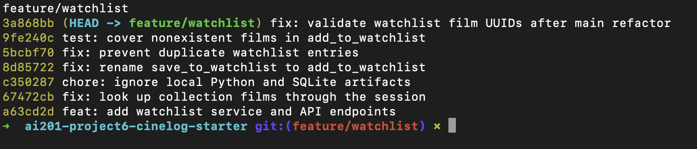

# PR Response Doc — CineLog Watchlist Feature

## AI Usage

I used Codex to navigate the starter code, assist with the rename, deduplication, and missing-film test, and verify the changes. For Comments 4 and 5, I used it to compare visibility and sorting options and draft my responses.

I used Codex to help resolve the UUID rebase conflict and verify the resulting API behavior with Flask's test client.

I used Codex to check the final commit subjects and review the patches for unrelated changes. During interactive rebase I folded the watchlist setup adjustments into the original feature commit and kept the collection lookup fix separate.

## Comment 1 — Rename

I renamed `save_to_watchlist()` to `add_to_watchlist()` to match `add_to_collection()` and make the add operation consistent across the two services. A repository-wide `rg` search across Python files found the definition in `services/watchlist_service.py` and the import and call in the POST handler in `routes/watchlist/watchlist.py`. After updating all three references, I searched for both names and found only the new name. All four tests passed with `python -m pytest tests/ -v`.

## Comment 2 — Deduplication

I followed `add_to_collection()`, which validates that the film exists, looks up an existing entry by both `user_id` and `film_id`, and raises `AlreadyInCollectionError` before inserting if it finds a match. The watchlist now uses the same lookup, raises `AlreadyInWatchlistError` on a match, and returns HTTP 409 from the add endpoint. The pair lets different users save the same film. A matching database uniqueness constraint protects newly created databases from concurrent duplicate inserts. Existing databases need a schema migration to gain that constraint.

In an in-memory database, the first POST returned 201, the repeat POST returned 409, and the first user still had exactly one entry for the film. A second user could add the same film, and a direct duplicate insert was rejected by the database. All four existing tests passed with `python -m pytest tests/ -v`.

## Comment 3 — Missing test

I modeled `test_add_to_watchlist_nonexistent_film_raises` on `test_add_to_collection_nonexistent_film_raises` in `tests/test_collection.py`. Both tests create a real user in an isolated in-memory SQLite database and pass an ID that has no film record. The watchlist test uses `pytest.raises(FilmNotFoundError)` to verify that the service reports a missing catalog film through the same exception as the collection service. The targeted test passed, and the full suite passed with five tests.

## Comment 4 — Default visibility

I'd keep `public=True`. I thought about how I'd use CineLog to pick a movie with a friend. Their collection tells me what they've already seen. Their watchlist could tell me whether there's something we both still want to see. If we can see each other's lists, I can suggest a film we've both saved without asking them to share a list first.

I'd also want to save some films just as reminders for myself. Private by default would make that easier because I wouldn't have to think about sharing each time I saved a film. I'd still default to public for the shared movie-picking use case and let people choose private when they add a title if we expose that option. Right now, `public` is stored as metadata. The read endpoint would need caller identity and an access check to honor it.

## Comment 5 — Sort order

I'd keep the watchlist alphabetical. If someone recommends *Alien* and I think I saved it a while ago, I'd look under A. I probably wouldn't remember whether I added it last week or six months ago. That's the lookup I'd want the default order to make easy.

I see the case for newest-first. If I saved a few recommendations last night and opened CineLog tonight to pick one, I'd want those at the top. That order also makes sense for my collection when I'm checking what I've watched lately. A watchlist is something I'd expect to come back to over months, so I'd make it easy to find a title even after it stops being a recent save. If we see that people mostly open their watchlists to pick from their latest saves, I'd revisit the default.

## Comment 6 — Rebase

I fetched `origin` and rebased `feature/watchlist` onto `origin/main`. Git stopped in `models.py` while replaying the original watchlist commit. The feature branch used an indexed integer column for `WatchlistEntry.film_id`, while `main` used a 36-character string to match the new UUID `Film.id`. I kept the UUID column and foreign key from `main` and preserved the feature branch's index, then staged the resolution and continued the rebase.

After the rebase, I updated the watchlist service contract and POST endpoint in a separate UUID fix. The route parses film IDs as UUID strings, returns HTTP 400 for malformed IDs, and returns HTTP 404 for valid UUIDs absent from the catalog. All five tests passed. An in-memory API check confirmed a UUID could be added and read back, an uppercase representation of the same UUID hit the duplicate check, and the invalid and missing IDs returned the expected errors. `git merge-base --is-ancestor origin/main HEAD` confirmed the new base, and `git log --merges --oneline origin/main..HEAD` returned no commits.

## Commit History



The screenshot shows `git log --oneline origin/main..HEAD` immediately before the final documentation commit.

## PR Description

The watchlist lets CineLog users save films they plan to watch and retrieve their saved titles. The API accepts catalog film UUIDs and prevents the same user from saving a title twice.

- **Default visibility** is public so members can discover films they both want to watch. The current API stores the visibility flag as metadata.
- **Default sort order** is alphabetical by title so a film stays easy to find as the list grows.

### Manual testing

1. In a virtual environment, install the dependencies with `python -m pip install -r requirements.txt`. Seed a fresh SQLite database and start Flask from the repository root.

   ```bash
   export DATABASE_URL=sqlite:///"$(mktemp -d)/cinelog.db"
   python seed.py
   python app.py
   ```

2. In a second terminal, run `curl -s http://127.0.0.1:5000/films/`. Copy the IDs for *Paddington 2* and *Alien* from the response and the user ID printed by the seed script.

   ```bash
   USER_ID='<demo user ID>'
   PADDINGTON_ID='<Paddington 2 UUID>'
   ALIEN_ID='<Alien UUID>'
   BASE_URL="http://127.0.0.1:5000/watchlist/$USER_ID"

   add_film() {
     curl -si -H 'Content-Type: application/json' \
       --data "{\"film_id\":\"$1\"}" "$BASE_URL/add"
   }
   ```

3. Run `add_film "$PADDINGTON_ID"` and then `add_film "$ALIEN_ID"`. Each request should return HTTP 201 with the film UUID and `"public": true`.
4. Run `curl -s "$BASE_URL"`. Verify that *Alien* appears before *Paddington 2* although it was added second.
5. Run `add_film "$ALIEN_ID"` again. Expect HTTP 409. Fetch the list again to confirm *Alien* appears once.
6. Run `add_film 00000000-0000-0000-0000-000000000000`. Expect HTTP 404. Run `add_film 123` and expect HTTP 400.
7. Run `python -m pytest tests/ -v` to verify the test suite.
